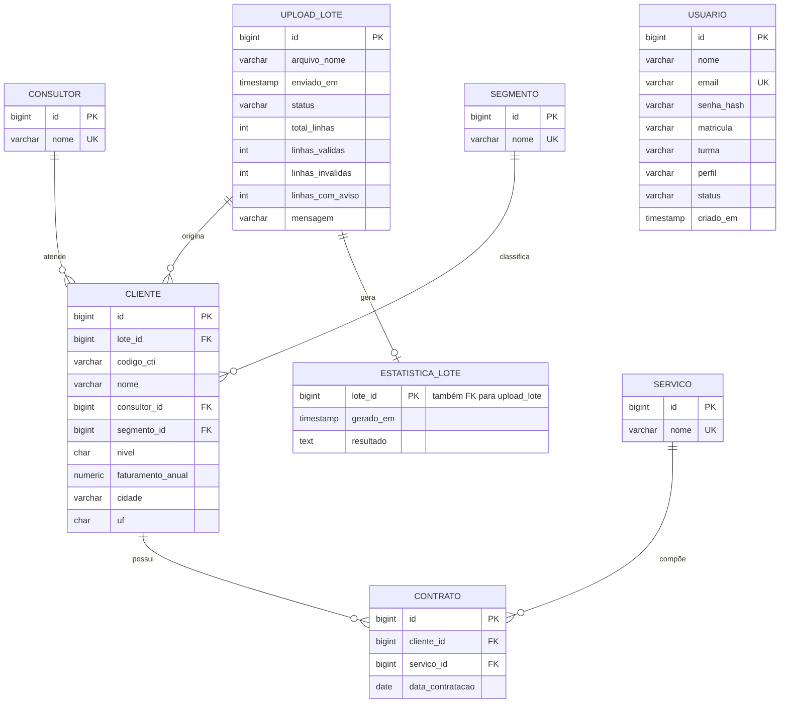

# CTI Insights

Desenvolvido como projeto integrador do Segundo Semestre/2026 das unidades curriculares **Frameworks Front-end**, **Desenvolvimento Back-end**, **Ciência de Dados**, **Automação Industrial**, **Computação em Nuvem** e **Relações Humanas e Cidadania** do curso de Análise e Desenvolvimento de Sistemas do **SENAI**, a partir da SAG (Situação de Aprendizagem) proposta para a empresa Provedor CTI.

Aplicação web para validação e análise das planilhas comerciais da **Provedor CTI**. O usuário envia a planilha de clientes, vê os erros antes do envio e acompanha os indicadores da carteira em um dashboard. Somente dados válidos são gravados.


| Serviço | Endereço |
|---|---|
| Aplicação (front-end) | https://cti-projeto-deploy.vercel.app |
| API (back-end) | https://cti-api-2plx.onrender.com/api/health |
| Serviço de dados (Python) | https://cti-python.onrender.com/saude |

---

## Funcionalidades

**Usuário**

- `RF-001` Cadastrar usuário: criação de conta com nome, e-mail, senha, matrícula e turma; a conta fica pendente até a aprovação
- `RF-002` Entrar no sistema: login com e-mail e senha, com emissão de token JWT
- `RF-003` Sair do sistema: encerramento da sessão; a sessão também expira automaticamente

**Administração**

- `RF-004` Listar usuários: consulta das contas, com filtro por status (pendente, aprovado ou bloqueado)
- `RF-005` Aprovar usuário: liberação do acesso de uma conta pendente
- `RF-006` Bloquear usuário: suspensão do acesso de uma conta

**Planilha**

- `RF-007` Importar planilha: envio de arquivo `.xlsx` de até 5 MB, por clique ou arrastar e soltar
- `RF-008` Validar planilha: conferência de cada linha no navegador, com relatório dos erros por linha e coluna
- `RF-009` Enviar linhas válidas: apenas as linhas sem erro seguem para o servidor, que as valida novamente
- `RF-010` Processar dados: padronização de nomes, segmentos, valores e datas e gravação de clientes, consultores, segmentos, serviços e contratos

**Dashboard**

- `RF-011` Visualizar indicadores: total de clientes, faturamento total, média, mediana e desvio padrão
- `RF-012` Visualizar gráficos: clientes por segmento e por nível, faturamento por consultor, serviços mais contratados e contratações por mês
- `RF-013` Consultar maiores clientes: os cinco clientes com maior faturamento
- `RF-014` Ler análises: frases geradas automaticamente a partir dos indicadores
- `RF-015` Consultar planilhas anteriores: seleção de um lote já processado

## Tecnologias

| Camada | Tecnologias |
|---|---|
| Front-end | Vue 3, Vite, Pinia, Vue Router, Axios, Tailwind CSS, Chart.js |
| Back-end | Java 21, Spring Boot 3.5, Spring Security, JWT, Spring Data JPA |
| Ciência de dados | Python, FastAPI, pandas, SciPy, SQLAlchemy |
| Banco de dados | PostgreSQL (Neon) |
| Hospedagem | Vercel (front-end) e Render (back-end e Python) |

## Fluxo de dados


## Banco de dados



A tabela `usuario` é gravada pelo back-end. As demais são gravadas pelo serviço Python a cada planilha processada.

## Estrutura do repositório

```
├── frontend/           # aplicação Vue
├── backend/            # API Spring Boot
├── analytics-python/   # ETL e estatística (FastAPI)
├── database/           # schema e consultas SQL
├── docs/               # guias de execução e deploy
├── sample-data/        # planilha de exemplo
└── testes/             # teste integrado
```

## Como executar

**Pré-requisitos:** Node.js 20+, Java 21, Maven 3.9+, Python 3.10+ e um banco PostgreSQL (Neon).

Em cada pasta (`frontend`, `backend` e `analytics-python`), copie `.env.example` para `.env` e preencha as variáveis. Depois, inicie os serviços nesta ordem:

```bash
# 1. Python (porta 8000)
cd analytics-python
python -m venv .venv
.venv\Scripts\activate        # Linux/macOS: source .venv/bin/activate
pip install -r requirements.txt
uvicorn api:app --port 8000

# 2. Back-end (porta 8080)
cd backend
mvn spring-boot:run

# 3. Front-end (porta 5173)
cd frontend
npm install
npm run dev
```

Acesse http://localhost:5173. As tabelas e o usuário administrador são criados automaticamente na primeira execução do back-end.

### Variáveis de ambiente

| Serviço | Variáveis |
|---|---|
| `frontend` | `VITE_API_URL` |
| `backend` | `DB_URL`, `DB_USER`, `DB_PASSWORD`, `JWT_SECRET`, `CORS_ORIGINS`, `ADMIN_EMAIL`, `ADMIN_PASSWORD`, `ETL_URL`, `ETL_KEY` |
| `analytics-python` | `DB_HOST`, `DB_PORT`, `DB_NAME`, `DB_USER`, `DB_PASSWORD`, `DB_SSLMODE`, `ETL_API_KEY` |

`ETL_KEY` (back-end) e `ETL_API_KEY` (Python) devem ter o mesmo valor.

## API

| Método | Rota | Acesso |
|---|---|---|
| `POST` | `/api/auth/register` | Público |
| `POST` | `/api/auth/login` | Público |
| `GET` | `/api/auth/me` | Autenticado |
| `GET` | `/api/admin/usuarios` | Administrador |
| `PATCH` | `/api/admin/usuarios/{id}/status` | Administrador |
| `POST` | `/api/uploads/validadas` | Autenticado |
| `GET` | `/api/dashboard` | Autenticado |
| `GET` | `/api/dashboard/lotes` | Autenticado |

Rotas autenticadas exigem o cabeçalho `Authorization: Bearer <token>`. O formato dos dados trocados entre os serviços está em [`docs/CONTRATO.md`](docs/CONTRATO.md).

## Testes

```bash
python testes/testar_tudo.py
```

O script verifica o serviço Python e as rotas principais do back-end. Com a planilha `sample-data/dados.xlsx`, o resultado esperado é 38 linhas lidas, 32 válidas e 6 rejeitadas.

## Documentação

- [Back-end](backend/README.md)
- [Front-end](frontend/README.md)
- [Ciência de dados](analytics-python/README.md)
- [Banco de dados](database/README.md)
