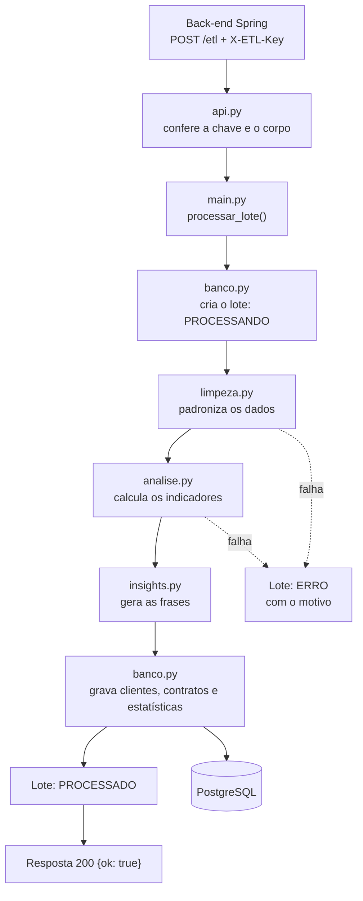

# CTI Insights · Ciência de dados

Serviço em **Python** responsável pelo ETL do CTI Insights. Recebe do back-end as linhas já validadas, padroniza os dados, calcula os indicadores estatísticos da carteira, gera as análises em texto e grava tudo no PostgreSQL. O dashboard do front-end exibe o resultado gravado por este serviço.

| | Endereço |
|---|---|
| Serviço em produção | https://cti-python.onrender.com/saude |
| Documentação da API (Swagger) | https://cti-python.onrender.com/docs |
| Documentação da API (ReDoc) | https://cti-python.onrender.com/redoc |

## Tecnologias

| Pacote | Uso |
|---|---|
| FastAPI + Uvicorn | API HTTP e servidor |
| Pydantic | Validação do corpo das requisições |
| pandas + NumPy | Tratamento dos dados em tabelas |
| SciPy | Correlação de Pearson e Spearman |
| SQLAlchemy + psycopg | Conexão e gravação no PostgreSQL |
| python-dotenv | Leitura das variáveis de ambiente |

## Fluxo dos dados

1. O back-end envia as linhas válidas para `POST /etl`, com a chave de acesso no cabeçalho `X-ETL-Key`.
2. O serviço cria o registro do lote com status **PROCESSANDO**. É esse status que o dashboard exibe enquanto o processamento acontece.
3. Os dados são padronizados, os indicadores são calculados e as frases de análise são geradas.
4. Clientes, consultores, segmentos, serviços, contratos e o JSON de estatísticas são gravados, e o lote passa para **PROCESSADO**.
5. Se qualquer etapa falhar, o lote é marcado como **ERRO** com o motivo, que aparece no dashboard, e a API responde `500`.

O serviço não devolve os dados calculados ao back-end: ele grava no banco e responde apenas que o processamento terminou.

## Etapas do processamento

### Limpeza e padronização · `limpeza.py`

| Dado | Tratamento |
|---|---|
| Textos | Remove espaços extras no início, no fim e entre palavras |
| Consultor | Formato de nome próprio: `ANA SOUZA` → `Ana Souza`, mantendo `de`, `da`, `do` em minúsculo |
| Segmento | Converte variações para o nome oficial: `IND.`, `industria` e `industrial` → `Indústria`; `TI` → `Tecnologia` |
| Serviços | Separa a lista por `;`, remove repetições e padroniza os nomes (`Internet Dedicada`, `Link Empresarial`, `Firewall`, `Backup`, `MPLS`, `Cloud`) |
| Faturamento | Converte texto em número, aceitando `R$`, ponto de milhar e vírgula decimal |
| Data | Aceita `aaaa-mm-dd` e `dd/mm/aaaa` |

Como proteção adicional, linhas com campo obrigatório inválido, segmento não reconhecido, nível fora de A/B/C, faturamento negativo ou código duplicado são descartadas nesta etapa.

### Indicadores · `analise.py`

| Grupo | Indicadores |
|---|---|
| Resumo geral | Total de clientes, faturamento total, média, mediana, desvio padrão, mínimo, máximo, quartis (Q1 e Q3) e coeficiente de variação |
| Mais frequentes | Segmento, nível e serviço mais frequentes; média de serviços por cliente; número de consultores |
| Por segmento, nível e consultor | Clientes, percentual de clientes, faturamento total e percentual do faturamento, média, mediana, desvio padrão, mínimo e máximo |
| Por serviço | Clientes que contrataram, percentual e faturamento médio |
| Por mês | Contratações, faturamento e total acumulado |
| Correlação | Pearson e Spearman entre a quantidade de serviços e o faturamento, com interpretação da força da relação |
| Maiores clientes | Os cinco clientes de maior faturamento |
| Qualidade | Linhas recebidas, válidas e inválidas |

### Análises em texto · `insights.py`

Gera frases em português a partir dos indicadores, exibidas no dashboard:

- segmento com a maior carteira;
- comparação entre média e mediana, indicando se poucos clientes grandes elevam a média;
- participação dos clientes nível A no faturamento;
- consultor com maior faturamento sob gestão;
- serviço mais contratado;
- distribuição das contratações ao longo dos meses;
- força e sentido da correlação entre serviços e faturamento.

### Gravação · `banco.py`

Único módulo que acessa o banco. Grava o lote em `upload_lote`, os dados em `cliente`, `consultor`, `segmento`, `servico` e `contrato`, e o JSON completo dos indicadores em `estatistica_lote`, de onde o dashboard lê. Consultores, segmentos e serviços são reaproveitados quando já existem. Toda a gravação de um lote acontece em uma única transação.

## API

O FastAPI gera duas documentações da API automaticamente:

| Documentação | Uso | Produção | Local |
|---|---|---|---|
| Swagger UI | Consultar as rotas e testá-las pelo navegador | https://cti-python.onrender.com/docs | http://localhost:8000/docs |
| ReDoc | Leitura da especificação, com os modelos de dados de cada rota | https://cti-python.onrender.com/redoc | http://localhost:8000/redoc |

| Método | Rota | Função |
|---|---|---|
| `GET` | `/saude` | Verifica se o serviço está no ar |
| `POST` | `/etl` | Processa e grava um lote enviado pelo back-end |
| `POST` | `/testar` | Processa uma lista de linhas e devolve os indicadores, **sem gravar** no banco |

### `GET /saude`

Responde `{"status": "ok"}`. Usado para verificar o serviço localmente e em produção.

### `POST /etl`

Chamado exclusivamente pelo back-end.

**Cabeçalho:** `X-ETL-Key`, com o mesmo valor de `ETL_API_KEY`. Se a variável estiver vazia, a chave não é exigida.

**Corpo:**

| Campo | Tipo | Descrição |
|---|---|---|
| `arquivoNome` | texto | Nome da planilha enviada |
| `recebidas` | número | Total de linhas da planilha, válidas e inválidas |
| `invalidas` | número | Linhas descartadas pelo front-end e pelo back-end |
| `comAviso` | número | Linhas válidas que tinham aviso |
| `linhas` | lista | Linhas válidas, com as colunas da planilha em `snake_case` |

**Respostas:**

| Código | Situação |
|---|---|
| `200` | Lote processado e gravado: `{"ok": true}` |
| `401` | Chave `X-ETL-Key` ausente ou incorreta |
| `422` | Nenhuma linha enviada |
| `500` | Falha no processamento; o lote fica com status `ERRO` e o motivo |

### `POST /testar`

Recebe uma lista de linhas, executa a limpeza e os cálculos e devolve o JSON de indicadores. Não acessa o banco. Serve para testar o processamento com o arquivo `amostras/clientes.json`.

## Estrutura

| Arquivo | Responsabilidade |
|---|---|
| `api.py` | Rotas da API e verificação da chave |
| `main.py` | Coordena o processamento de um lote |
| `limpeza.py` | Limpeza e padronização |
| `analise.py` | Cálculo dos indicadores |
| `insights.py` | Frases de análise |
| `banco.py` | Conexão e gravação no PostgreSQL |
| `config.py` | Leitura do `.env` e montagem da conexão |
| `testar_conexao.py` | Teste de conexão com o banco |
| `amostras/clientes.json` | Linhas de exemplo para testes |

## Configuração

Copie `.env.example` para `.env` e preencha:

| Variável | Descrição |
|---|---|
| `DB_HOST` | Servidor do banco (no Neon, o host da string de conexão) |
| `DB_PORT` | Porta, normalmente `5432` |
| `DB_NAME` | Nome do banco |
| `DB_USER`, `DB_PASSWORD` | Credenciais |
| `DB_SSLMODE` | `require` para Neon e Azure |
| `ETL_API_KEY` | Chave exigida no cabeçalho `X-ETL-Key`; deve ser igual a `ETL_KEY` do back-end |

## Execução

Na pasta `analytics-python`, crie um ambiente virtual com `python -m venv .venv` e ative-o (`.venv\Scripts\activate` no Windows ou `source .venv/bin/activate` no Linux e macOS). Instale as dependências com `pip install -r requirements.txt` e inicie o serviço com `uvicorn api:app --port 8000`.

O serviço fica disponível em http://localhost:8000, com a documentação interativa em http://localhost:8000/docs.

## Testes

### 1. Conexão com o banco

O script `testar_conexao.py` verifica se as credenciais do `.env` dão acesso ao PostgreSQL. Ele mostra a versão do banco e a quantidade de lotes já gravados, ou avisa se as tabelas ainda não foram criadas pelo back-end.

### 2. Processamento sem gravar

Com o serviço em execução, abra o Swagger (https://cti-python.onrender.com/docs ou http://localhost:8000/docs), escolha a rota `POST /testar` e envie o conteúdo de `amostras/clientes.json`. A resposta traz os indicadores calculados, e nada é gravado no banco. É a forma mais rápida de conferir mudanças na limpeza ou nos cálculos.

### 3. Teste integrado

O script `testes/testar_tudo.py`, na raiz do repositório, verifica o sistema em quatro partes. As partes cujo serviço não está em execução aparecem como **PULOU**.

| Parte | O que verifica | Requer |
|---|---|---|
| 1. Ciência de dados | Consultores convertidos para nome próprio (`Ana Souza`, `Carlos Lima`); segmentos padronizados (`Indústria`, `Comércio`); média e mediana iguais a 1.135.000 na amostra | Dependências instaladas |
| 2. API Python | `/saude` responde `ok`; `/testar` calcula sem gravar | Serviço Python |
| 3. Back-end | Health check; login do administrador; upload sem token recusado (`401`); upload sem linhas recusado (`400`) | Back-end |
| 4. Dashboard | Dashboard sem token recusado; lista de lotes; estatísticas com os dados dos gráficos | Back-end e banco com um lote |

Com a opção `--gravar`, o script também envia duas linhas de teste: uma válida e uma com nível inválido. O esperado é resposta `201`, uma linha gravada e uma devolvida em `rejeitadas`.

O resultado final mostra a contagem de **OK**, **FALHA** e **PULOU**. O sistema está pronto quando não há nenhuma falha.

### 4. Planilha completa

Enviando `sample-data/dados.xlsx` pelo site, o banco deve conter:

| Verificação | Esperado |
|---|---|
| Linhas do lote (total / válidas / inválidas) | 38 / 32 / 6 |
| Clientes | 32 |
| Segmentos / consultores / serviços | 6 / 4 / 6 |
| Contratos | 61 |
| Média de faturamento | R$ 2.261.250,00 |

As consultas para conferir esses valores estão em `database/consultas-neon.sql`.
