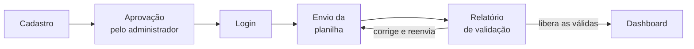
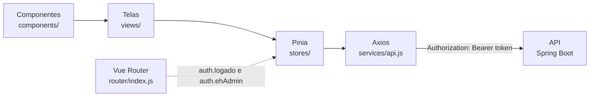

# CTI Insights · Front-end

Interface web do CTI Insights em **Vue 3**, projetada para que o usuário envie a planilha de clientes com segurança: ele vê os erros antes de qualquer gravação, entende como corrigi-los e só então libera os dados. Depois, acompanha os indicadores da carteira em um dashboard de leitura rápida.

**Aplicação:** https://cti-projeto-deploy.vercel.app

## Tecnologias

| Pacote | Uso | Documentação |
|---|---|---|
| Vue 3 | Framework da interface (Composition API, `<script setup>`) | https://vuejs.org |
| Vite | Servidor de desenvolvimento e build | https://vite.dev |
| Vue Router 4 | Navegação entre telas e controle de acesso | https://router.vuejs.org |
| Pinia 2 | Estado global: sessão e planilha | https://pinia.vuejs.org |
| Axios 1 | Comunicação com a API | https://axios-http.com |
| read-excel-file | Leitura do `.xlsx` no navegador | https://www.npmjs.com/package/read-excel-file |
| Chart.js 4 | Gráficos do dashboard | https://www.chartjs.org |
| Tailwind CSS 4 | Estilização | https://tailwindcss.com |

## Experiência do usuário (UX)

### Jornada



O fluxo principal tem três passos: **enviar**, **conferir** e **liberar**. O usuário nunca grava dados sem antes ver o resultado da validação.

### Decisões de UX

| Princípio | Como aparece na interface |
|---|---|
| Feedback antes do compromisso | A planilha é validada no navegador, sem envio ao servidor. O relatório mostra o que será enviado antes de qualquer gravação |
| Erros compreensíveis | Cada erro indica a linha do Excel, a coluna e como corrigir, em português: `nivel_cliente: 'E' inválido (use A, B ou C)` |
| Prevenção de erros | O botão de envio fica desabilitado quando não há linhas válidas e informa a quantidade (`Liberar 32 linhas para o back-end`). Colunas ausentes no cabeçalho são apontadas antes da validação |
| Visibilidade do estado do sistema | Textos de progresso (`Lendo a planilha...`, `Enviando...`, `Carregando...`), botões desabilitados durante as requisições e etiquetas de status coloridas. Enquanto o lote está em processamento, o dashboard se atualiza sozinho a cada 5 segundos |
| Confirmação e próximo passo | Após o envio, a mensagem de sucesso informa quantas linhas foram gravadas e oferece o atalho **Ver os gráficos** |
| Estados vazios orientados | Sem planilha processada, o dashboard explica a situação e leva para **Enviar planilha**. O relatório aberto sem arquivo também orienta o usuário |
| Interação direta | Área de arrastar e soltar com destaque visual quando o arquivo está sobre ela; clique para selecionar como alternativa |
| Menu de acordo com o perfil | Visitantes veem **Entrar** e **Cadastrar**; usuários logados veem **Enviar planilha** e **Gráficos**; o administrador vê também **Liberar acessos** |
| Continuidade | A sessão é mantida ao recarregar a página; quando o token expira, a sessão é encerrada e as telas protegidas pedem novo login |
| Responsividade | No celular, o menu vira um botão de abrir e fechar; tabelas largas ganham rolagem horizontal |

## Interface (UI)

### Cores

As cores seguem a identidade do SENAI e são definidas uma única vez em `style.css`, como tokens do Tailwind (`bg-azul`, `text-vermelho`...).

| Token | Cor | Uso |
|---|---|---|
| `azul` | `#0060a9` | Cabeçalho, botões principais e links |
| `azul-escuro` | `#003e73` | Títulos e rodapé |
| `azul-claro` | `#e6f0f8` | Fundos de destaque e cabeçalhos de tabela |
| `vermelho` | `#d71920` | Ação de envio, erros e bloqueio |
| `laranja` | `#f7941d` | Avisos e itens pendentes |
| `verde` | `#1f8a4c` | Sucesso e itens aprovados |
| `cinza` | `#52606d` | Textos secundários |
| `fundo` | `#f4f6f8` | Fundo das páginas |

O significado das cores é o mesmo em todo o sistema: **verde** indica sucesso (`APROVADO`, `PROCESSADO`), **laranja** indica espera (`PENDENTE`, `PROCESSANDO`) e **vermelho** indica erro (`BLOQUEADO`, `ERRO`, linhas inválidas).

### Tipografia

Fonte **Barlow** (pesos 400, 600 e 700), servida localmente pelo pacote `@fontsource/barlow`, sem depender de serviços externos.

### Componentes visuais

| Componente | Função |
|---|---|
| `AppHeader` | Cabeçalho com logotipo e menu adaptado ao perfil e ao tamanho da tela |
| `KpiCard` | Cartão com um indicador em destaque (linhas lidas, média, mediana...) |
| `StatusBadge` | Etiqueta de status com a cor correspondente |
| `BaseChart` | Gráfico de barra, linha ou rosca; reutilizado em todos os gráficos do dashboard |

## Arquitetura

As telas não chamam a API diretamente: toda requisição passa por uma store (Pinia) e pelo cliente HTTP (Axios). O Vue Router consulta a store de sessão para liberar ou bloquear cada tela.



## Estrutura

```
src/
├── main.js            # cria o app, registra Pinia e Router e valida a sessão salva
├── App.vue
├── router/index.js    # rotas e guarda de navegação
├── stores/
│   ├── auth.js        # sessão do usuário
│   └── upload.js      # leitura, validação e envio da planilha
├── services/api.js    # instância do Axios e funções de cada rota
├── views/             # telas
└── components/        # AppHeader, BaseChart, KpiCard, StatusBadge
```

## Pinia

O Pinia guarda os dados compartilhados entre as telas. Cada store é organizada em três partes:

| Parte | O que é | No código (setup store) |
|---|---|---|
| **State** | Os dados guardados pela store | `ref()` |
| **Getters** | Valores calculados a partir do state; atualizam sozinhos quando o state muda | `computed()` |
| **Actions** | Funções que alteram o state e chamam a API | funções comuns, `async` quando fazem requisição |

### `stores/auth.js` · sessão

**State**

| Nome | Descrição |
|---|---|
| `token` | Token JWT recebido no login |
| `usuario` | Dados do usuário logado (nome, e-mail e perfil) |

**Getters**

| Nome | Descrição |
|---|---|
| `logado` | `true` quando existe token; usado pelo Vue Router e pelo menu |
| `ehAdmin` | `true` quando o perfil é `ADMIN`; libera a tela de liberação de acesso |

**Actions**

| Nome | Descrição |
|---|---|
| `entrar(email, senha)` | Chama `POST /auth/login` e salva token e usuário |
| `cadastrar(dados)` | Chama `POST /auth/register`; a conta é criada como pendente |
| `sair()` | Limpa o state e o `localStorage` |
| `validarSessao()` | Ao abrir o site, confere o token salvo com `GET /auth/me`; se inválido, chama `sair()` |

O state é persistido no `localStorage` na chave `cti-sessao`, o que mantém o usuário logado ao recarregar a página.

### `stores/upload.js` · planilha

**State**

| Nome | Descrição |
|---|---|
| `arquivoNome` | Nome do arquivo escolhido |
| `resultados` | Resultado da validação de cada linha (valores, erros e avisos) |
| `colunasFaltando` | Colunas obrigatórias ausentes no cabeçalho |
| `analisando`, `enviando` | Indicam leitura do arquivo e envio em andamento |
| `erro` | Mensagem de erro exibida na tela |
| `lote` | Resposta do back-end após o envio |

**Getters**

| Nome | Descrição |
|---|---|
| `validas` | Linhas sem erro, que serão enviadas |
| `invalidas` | Linhas com erro, que ficam de fora |
| `comAviso` | Linhas válidas que têm algum aviso |
| `podeLiberar` | Habilita o botão de envio quando há linhas válidas e nenhuma coluna faltando |

**Actions**

| Nome | Descrição |
|---|---|
| `analisarArquivo(arquivo)` | Confere extensão e tamanho (até 5 MB), lê a aba `upload_clientes` e valida cada linha |
| `liberarParaBackend()` | Envia somente as linhas de `validas` para `POST /uploads/validadas` |
| `limpar()` | Reinicia o state para um novo envio |

Regras aplicadas a cada linha, iguais às do back-end:

- colunas obrigatórias preenchidas e dentro do tamanho máximo;
- código do cliente único, com letras, números, `-` ou `_`;
- segmento reconhecido (Indústria, Comércio, Serviços, Saúde, Educação ou Tecnologia) e nível `A`, `B` ou `C`;
- faturamento numérico e não negativo (aceita `1850000`, `1.850.000,50` e `R$ 1.850.000,50`);
- ao menos um serviço, separados por `;`;
- data em `dd/mm/aaaa` ou `aaaa-mm-dd`, a partir de 1990;
- UF com duas letras, quando informada.

## Axios

Toda a comunicação com o back-end fica em `services/api.js`.

### Instância

A instância do Axios é criada com a URL da API lida de `VITE_API_URL` (sem barra no final) e tempo limite de 60 segundos para cada requisição.

### Interceptadores

| Interceptador | Função |
|---|---|
| Requisição | Adiciona `Authorization: Bearer <token>` em todas as chamadas |
| Resposta | Se a API responder `401` fora das rotas de login e cadastro, o token expirou: a sessão é encerrada |

Para evitar importação circular entre `api.js` e a store, a store de sessão entrega ao Axios as funções que leem o token e fazem logout, por meio de `configurarApi()`.

### Serviços

| Serviço | Função | Requisição |
|---|---|---|
| `authService` | `entrar(email, senha)` | `POST /auth/login` |
| | `cadastrar(dados)` | `POST /auth/register` |
| | `eu()` | `GET /auth/me` |
| `adminService` | `listar(status)` | `GET /admin/usuarios?status=` |
| | `alterarStatus(id, status)` | `PATCH /admin/usuarios/{id}/status` |
| `uploadService` | `enviarValidadas(dados)` | `POST /uploads/validadas` |
| `dashboardService` | `obter(loteId)` | `GET /dashboard?loteId=` |
| | `lotes()` | `GET /dashboard/lotes` |

A função `mensagemDeErro(erro)` converte qualquer falha em texto para a tela. O back-end responde erros no formato `{"erro": "mensagem"}`.

## Vue Router

O roteador usa `createWebHistory()` (URLs sem `#`) e carrega cada tela sob demanda com `import()`, reduzindo o tamanho do carregamento inicial.

| Rota | Tela | Meta | Acesso |
|---|---|---|---|
| `/` | `HomeView` | — | Público |
| `/login` | `LoginView` | `soVisitante` | Somente sem login |
| `/cadastro` | `CadastroView` | `soVisitante` | Somente sem login |
| `/upload` | `UploadView` | `requerLogin` | Autenticado |
| `/relatorio` | `RelatorioView` | `requerLogin` | Autenticado |
| `/dashboard` | `DashboardView` | `requerLogin` | Autenticado |
| `/admin/usuarios` | `AdminUsuariosView` | `requerLogin`, `requerAdmin` | Administrador |
| qualquer outra | `NotFoundView` | — | Público |

A guarda de navegação (`router.beforeEach`) é executada antes de cada troca de tela e consulta os getters da store de sessão:

- rota com `requerLogin` e usuário sem login → redireciona para `/login`;
- rota com `requerAdmin` e usuário sem perfil de administrador → redireciona para `/`;
- rota com `soVisitante` e usuário já logado → redireciona para `/upload`.

A guarda controla a navegação na interface. A proteção dos dados é feita pelo back-end, que exige o token em cada requisição.

## Dashboard

A tela `/dashboard` consulta `GET /api/dashboard` e exibe os dados calculados pelo serviço Python:

- indicadores: clientes, faturamento total, média, mediana e desvio padrão (`KpiCard`);
- gráficos de barra, linha e rosca com Chart.js (`BaseChart`): clientes por segmento e por nível, faturamento por consultor, serviços mais contratados e contratações por mês;
- os cinco maiores clientes e as análises do lote.

Lotes anteriores podem ser selecionados pela lista no topo da tela (`GET /api/dashboard/lotes`).

## Configuração

Copie o arquivo `.env.example` para `.env` e informe em `VITE_API_URL` o endereço da API, terminando em `/api` (em desenvolvimento, `http://localhost:8080/api`). Variáveis `VITE_` são lidas no momento do build: ao alterar o endereço, reinicie o servidor de desenvolvimento ou gere o build novamente.

## Execução

Instale as dependências com `npm install` e inicie o servidor de desenvolvimento com `npm run dev`. A aplicação abre em http://localhost:5173. O back-end precisa estar em execução para login, envio e dashboard.

## Build

O comando `npm run build` gera a versão de produção na pasta `dist/`, e `npm run preview` permite conferi-la localmente. O arquivo `vercel.json` redireciona todas as rotas para `index.html`, permitindo acessar diretamente endereços como `/dashboard`.
